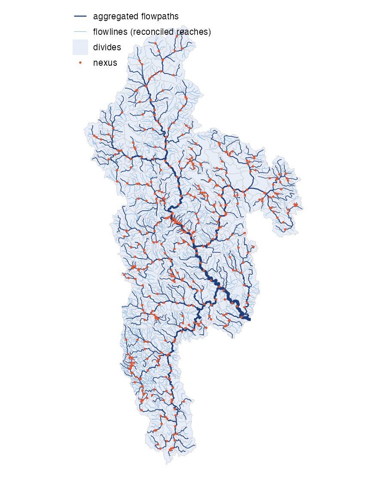
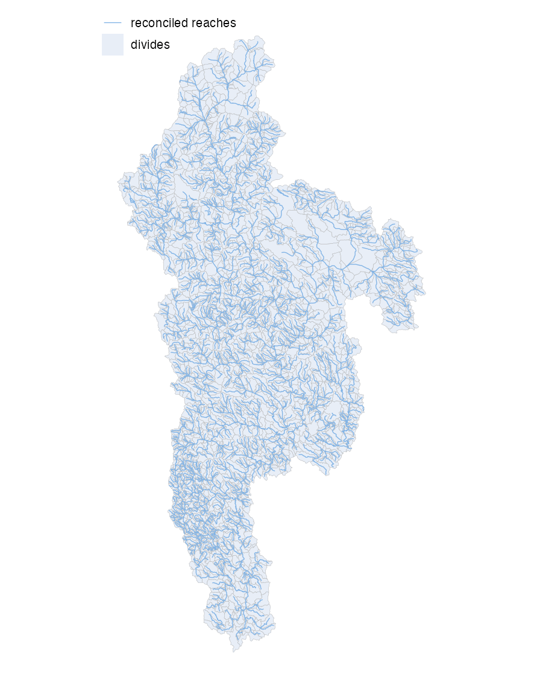
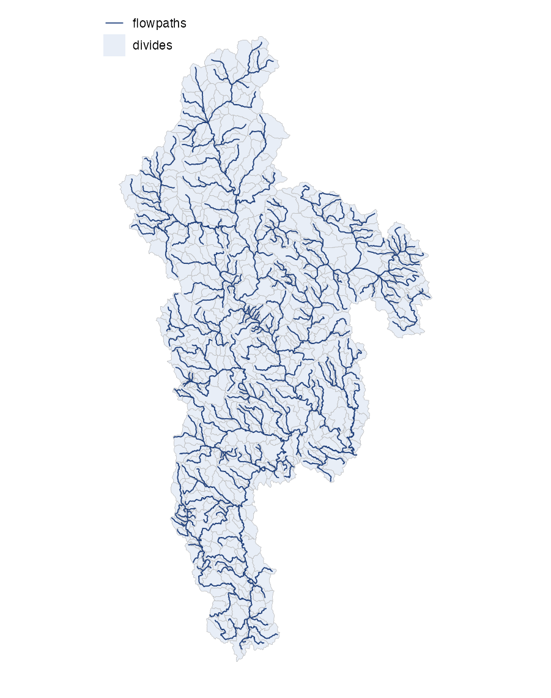
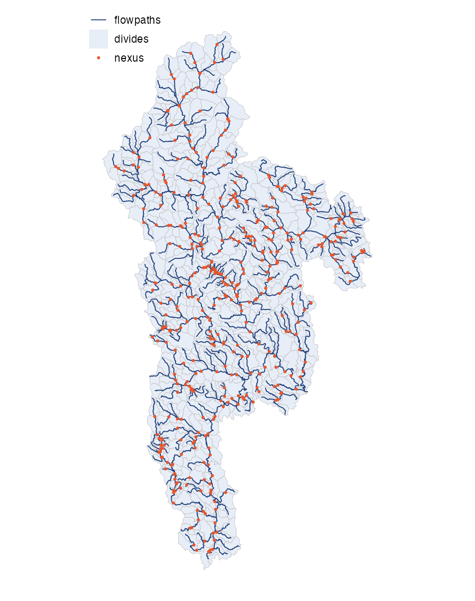

<!-- README.md is generated from README.Rmd. Please edit that file -->

# hydrofabric

`hydrofabric` builds hydrologic modeling fabrics from a reference hydrographic
network. It produced the NOAA Office of Water Prediction's National Water Model
v4 hydrofabric for the [NextGen framework](https://github.com/NOAA-OWP/ngen),
covering SuperCONUS, Alaska, Hawaii and Puerto Rico / Virgin Islands.



## Installation

```r
# install.packages("remotes")
remotes::install_github("NOAA-OWP/hydrofabric")
```

Requires GDAL >= 3.5, GEOS >= 3.11, PROJ >= 9, the `arrow` package for the
parquet inputs, and the [mapshaper](https://github.com/mbloch/mapshaper)
command-line tool (`npm install -g mapshaper`). The
[`hfutils`](https://github.com/NOAA-OWP/hfutils) dependency installs
automatically.

## Pipeline

A build runs in four phases: **refactor** the reference network against flow
direction and accumulation grids, **aggregate** it to distribution scale,
package it as a **NextGen** fabric, and **merge** the per-VPU products into
domains with globally unique identifiers. Every VPU must pass its invariant
checks before it is merged.









The terms used here (flowpath, divide, flowline, nexus, hydrolocation, VPU) are
those of the [hydrofabric data model](https://lynker-spatial.github.io/hfdatamodel/).

## Usage

One VPU:

```r
library(hydrofabric)

run_pipeline(
  vpuid               = "01",
  reference_gpkg      = "reference.gpkg",
  hydrolocations_gpkg = "hydrolocations.gpkg",
  fdr_path            = "fdr.vrt",
  fac_path            = "fac.vrt",
  out_dir             = "out"
)
```

The product is `out/vpu_01/ngen_vpu01.gpkg`; intermediates and the invariant
record are in `out/vpu_01/work/`. Each phase is also its own function:
`refactor_fabric()`, `aggregate_fabric()`, `nextgen_fabric()` and
`merge_vpus()`. `vignette("hydrofabric")` covers national builds and parameters.

## Reproducing the NWM v4 delivery

The staged inputs come with `input_manifest.json`, which records every file's
checksum. `scripts/run_vpu.R` verifies a local copy against it, then builds and
merges every VPU:

```sh
cd <inputs>
Rscript run_vpu.R 21     # one VPU
Rscript run_vpu.R all    # every VPU, then the merge
```

## Output

Each product is a GeoPackage with `flowpaths`, `divides`, `flowlines`, `nexus`,
`network`, `hydrolocations`, `pois`, `lakes`, and the `flowpath-attributes` and
`flowline-attributes` routing tables. See `vignette("nextgen")` for the schema
and `vignette("invariants")` for the checks every product passes.

## Tests

The unit and functional tests, including the acyclic and non-dendritic network
checks, run with `testthat::test_dir("tests/testthat")`. `vignette("tests")`
describes what they cover.

## License

Code is licensed under Apache-2.0 and data under
[CC BY-SA 4.0](https://creativecommons.org/licenses/by-sa/4.0/), both © Lynker
Corporation. CC BY-SA is required by TDX-Hydro, which Alaska and the CONUS
reference build on; it limits redistribution, not use. Each product carries its
license and source attribution in its own metadata. See `NOTICE` and
`THIRD_PARTY_NOTICES.md`.
