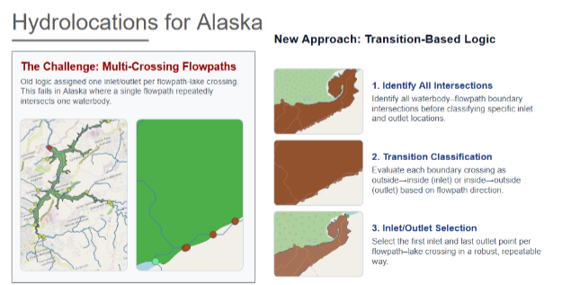
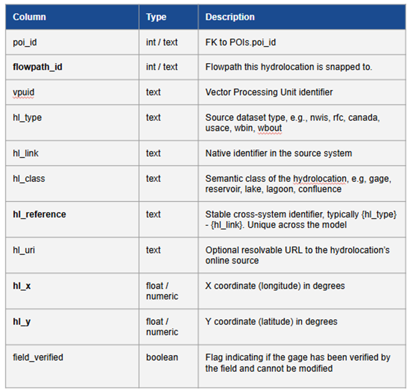
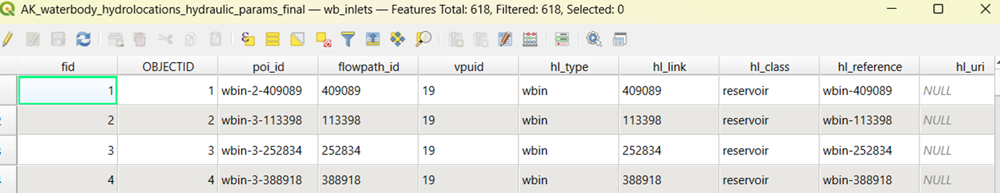
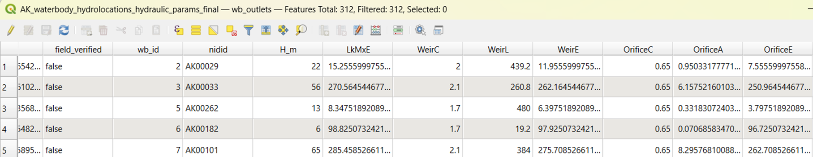

# Hydrolocation generation and regional methods

> Source: consolidated v3 technical documentation, draft v0.3. Preserve **TO CONFIRM** items pending code and dataset verification.

Waterbody Hydrolocation
Inlet/Outlet Generation

Hydrolocation and Hydraulic Parameter Technical Guide

PR/USVI • Hawaii • Alaska

| DRAFT v0.1 — Working documentation prepared for joint review before GitHub/AWS publication. Items marked [TO CONFIRM] should be finalized against the repository file names and final Hawaii production run. |
| --- |

Purpose: document the scripts, logic, required inputs, outputs, QA layers, domain-specific differences, and navigation structure needed to publish the hydrolocation workflow as a reproducible user-facing package.

## 1. Overview

The waterbody hydrolocation workflow identifies where Hydrofabric flowpaths enter and leave waterbodies and converts those intersections into standardized inlet (wbin) and outlet (wbout) points. The workflow began with the PR/USVI implementation, was extended to Hawaii, and was substantially revised for Alaska after QA exposed complex multi-crossing and re-entry cases.

- PR/USVI / Hawaii baseline: boundary intersections plus downstream network topology are used to generate inlet candidates and select one representative outlet per waterbody.

- Alaska transition-based version: preserves the complete crossing universe, classifies each crossing as outside→inside or inside→outside, and validates downstream re-entry before final selection.

- Final schema step: selected points are converted to the common Hydrofabric hydrolocation schema; outlet records may additionally carry waterbody hydraulic-control parameters.

Figure 1. Alaska workflow concept developed during QA: all crossings → transition classification → inlet/outlet selection.

### 1.1 Intended users

Hydrofabric developers, GIS/data scientists, model-data integrators, and reviewers generating or validating waterbody hydrolocations for oCONUS domains.

### 1.2 Scope of this guide

- What each script does and when to use it.

- Input data and required/optional attributes.

- Inlet/outlet selection logic.

- Differences among PR/USVI, Hawaii, and Alaska.

- QA products and recommended validation.

- Final Hydrofabric schema and hydraulic-parameter enrichment.

- Repository and AWS documentation structure.

## 2. Workflow at a Glance

| Stage | Purpose |
| --- | --- |
| 1. Prepare inputs | Read waterbody polygons and Hydrofabric flowpaths; validate geometry; harmonize CRS and identifiers. |
| 2. Find interactions | Identify flowpaths intersecting each waterbody and extract boundary crossing points. |
| 3. Classify/select | Determine inlet(s) and outlet candidate(s) using geometry plus network topology. |
| 4. Validate outlet | Use downstream connectivity and drainage-area/topology ranking to identify the representative outlet. |
| 5. QA | Retain diagnostic layers/attributes so selected points can be traced back to the full crossing set. |
| 6. Standardize | Create Hydrofabric hydrolocation fields and geographic coordinates. |
| 7. Parameterize outlets | Where applicable, attach waterbody/dam attributes and estimate weir/orifice controls. |

## 3. PR/USVI and Hawaii Baseline Workflow

The baseline implementation uses waterbody–flowpath boundary intersections together with flowpath orientation and downstream connectivity. This method performed well for the simpler intersection patterns encountered during PR/USVI development and formed the basis for the Hawaii implementation.

### 3.1 Inlet logic

- For each intersecting waterbody–flowpath pair, extract boundary intersection point(s).

- Select the boundary point closest to the upstream/start end of the flowpath as the inlet for that reach.

- Retain one inlet per waterbody–flowpath combination after deduplication.

### 3.2 Outlet logic

- Use flowpath_toid to retrieve the downstream neighbor of an intersecting reach.

- For reaches with multiple boundary points, select the crossing closest to the downstream-neighbor geometry as the outlet candidate.

- Prefer candidates whose downstream neighbor no longer intersects the waterbody.

- If multiple candidates remain, rank by total drainage area (totdasqkm), then hydroseq, then flowpath length.

- Use a boundary-based fallback when a usable downstream-toid candidate is unavailable.

| PR/USVI documented production result: 181 inlets + 33 outlets = 214 hydrolocations across 33 reservoirs/lagoons. Hawaii uses the same general baseline family; exact final Hawaii product counts and production filename are [TO CONFIRM]. |
| --- |

### 3.3 Why the baseline needed revision for Alaska

Alaska QA revealed cases in which a single flowpath crossed a waterbody boundary multiple times, started or ended inside a waterbody, temporarily exited and re-entered, or interacted with holes/complex polygon geometry. A single 'closest to start' inlet and simple downstream-neighbor outlet rule could therefore retain false inlets or temporary exits.

## 4. Alaska Transition-Based Workflow

The Alaska version changes the unit of reasoning from 'one intersection per reach' to the complete ordered sequence of boundary crossings. Each crossing is evaluated using the flowpath immediately before and after the boundary point.

| Alaska enhancement | Behavior |
| --- | --- |
| Complete crossing universe | Preserve every waterbody–flowpath boundary crossing for QA instead of immediately collapsing to one point. |
| Ordered crossings | Measure position along the flowpath and retain crossing_order. |
| Transition test | Sample immediately before/after the crossing to classify outside→inside (wbin), inside→outside (exit), or ambiguous/non-transition. |
| First true inlet | Keep the first valid outside→inside transition per waterbody–flowpath reach. |
| Final true exit | Use the last valid inside→outside transition as an outlet candidate. |
| Downstream re-entry validation | Follow the TOID chain to determine whether an apparent exit is temporary and subsequently re-enters the same waterbody. |
| Final outlet ranking | Choose one outlet per waterbody using topology and ranking fields, including totdasqkm, hydroseq, lengthkm and crossing order. |

### 4.1 Edge cases explicitly handled

- Multiple crossings on the same reach: first valid inlet and final valid outlet can both be retained.

- Reach starts inside the waterbody: do not create a false inlet from a later hole/re-entry crossing.

- Reach ends inside the waterbody: retain the inlet but do not manufacture an internal outlet.

- Temporary exit followed by re-entry: reject the temporary exit as the final waterbody outlet.

- Same reach contains both inlet and outlet: allowed when transition sequence supports both.

- Complex/coastal flow orientation: use topology/transition evidence rather than assuming every geometric crossing has the same meaning.

## 5. Key Differences by Domain / Script Family

| Topic | PR/USVI | Hawaii | Alaska |
| --- | --- | --- | --- |
| Primary selection concept | Closest-to-upstream boundary point + downstream-neighbor outlet logic | Same baseline family; domain inputs differ | Ordered transition classification + downstream re-entry validation |
| Crossing preservation | Primarily selected points | Primarily selected points | All crossings retained as QA universe |
| Inlet rule | One inlet per intersecting reach, nearest flowpath start | Same general rule | First true outside→inside transition per reach |
| Outlet rule | Candidate nearest downstream neighbor; one outlet/waterbody | Same general rule | Final true exit; reject exits that re-enter downstream |
| Multi-crossing support | Limited / not primary design case | Limited / not primary design case | Explicit |
| Starts/ends inside waterbody | Handled through baseline/fallback logic | Baseline/fallback logic | Explicit transition-state handling |
| QA outputs | Selected hydrolocations; domain QA as needed | Selected hydrolocations; domain QA as needed | All crossings + outlet candidates + selected inlet/outlet flags |
| Working CRS | Domain appropriate | Domain appropriate | EPSG:3338 in Alaska production script |
| Final schema | Common Hydrofabric hydrolocation schema | Common Hydrofabric hydrolocation schema | Common schema; outlets additionally support hydraulic controls |

## 7. Output Products and Hydrofabric Schema

The final output separates location records from hydraulic-control attributes. Inlets carry the core hydrolocation schema; outlets carry the same core schema and may retain hydraulic parameters.

Figure 2. Core Hydrofabric hydrolocation schema used as the target for standardized outputs.

Figure 3. Example Alaska inlet table after schema standardization.

Figure 4. Example Alaska outlet table with waterbody and hydraulic-control attributes.

| Core field | Role |
| --- | --- |
| poi_id | Unique hydrolocation/POI identifier |
| flowpath_id | Hydrofabric flowpath associated with the hydrolocation |
| vpuid | Vector Processing Unit identifier |
| hl_type | wbin or wbout |
| hl_link | Native/source link identifier |
| hl_class | reservoir for dam-associated features; waterbody otherwise |
| hl_reference | Stable cross-system hydrolocation reference |
| hl_uri | Optional resolvable source URL; NULL when unavailable |
| hl_x / hl_y | Longitude / latitude in degrees |
| field_verified | Field-verification flag |

