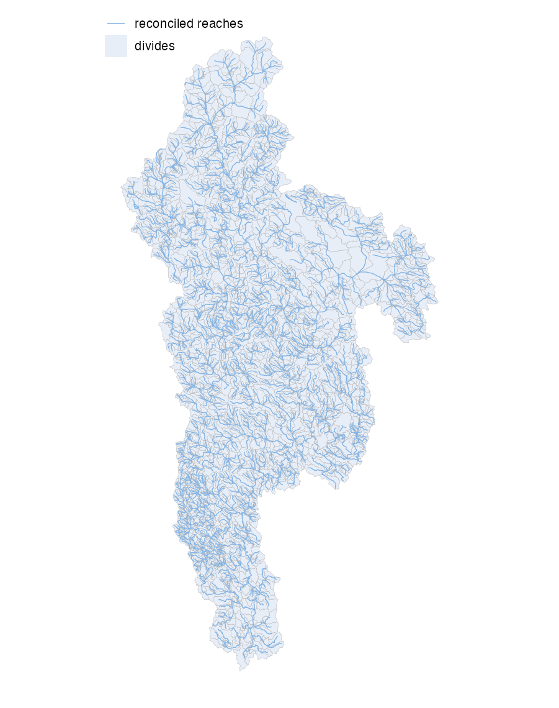

```{r, include = FALSE, purl=FALSE}
knitr::opts_chunk$set(collapse = TRUE, comment = "#>", eval = FALSE)
```

`refactor_fabric()` is the first and most compute-intensive phase: it takes the
reference network + FDR/FAC grids and produces a **refactored, reconciled**
fabric with a full lineage back to the source reference ids.

## Inputs and outputs

**Inputs**: the reference GeoPackage (`flowpaths` + `divides`), the
hydrolocations (embedded or via `hydrolocations_gpkg`), and the FDR/FAC grids.

**Outputs** (written to `{out_dir}/vpu_{vpuid}/work/`):

- `refactored.gpkg`: split/collapsed flowpaths
- `reconciled.gpkg`: reconciled flowpaths + divides + events
- `rec_fp_agg.gpkg`, `rec_div.gpkg`: reconciled aggregation inputs
- `pois.gpkg`, `hydrolocations.gpkg`: event-bearing POIs
- `lineage.parquet`: reference id to reconciled id crosswalk



## What it does

1. **Generate events** from the hydrolocations (`tolerance_m` snap), plus
   junction events at confluences.
2. **Split and collapse** flowlines (`refactor_flowlines()`): collapse
   inter-confluence segments shorter than `collapse_flines_meters`, then assert
   the network is a DAG and recompute hydrosequence.
3. **Reconcile divides** against the refactored flowlines
   (`reconcile_divides()`): each parent divide is partitioned from the FDR/FAC
   grids. This is the slowest step and runs in parallel across divides.
4. **Build the lineage** table (reference id to reconciled id).

## Running it

```{r, purl=FALSE}
library(hydrofabric)
refactor_fabric(
  vpuid          = "01",
  reference_gpkg = "reference.gpkg",
  hydrolocations_gpkg = "hydrolocations.gpkg",  # optional if bundled
  fdr_path       = "fdr.vrt",
  fac_path       = "fac.vrt",
  out_dir        = "out"
)
```

## Parameters

| Parameter | Default | Controls |
|---|---|---|
| `tolerance_m` | 500 | POI snap tolerance (m) |
| `snap_threshold_m` | 250 | warn if a snap exceeds this |
| `collapse_flines_meters` | 250 | minimum inter-confluence segment length |
| `split_flines_meters` | 1e9 | refactor-phase split length (disabled by default; routing-unit splitting happens in the nextgen phase) |
| `force_lr` | TRUE | force left/right event assignment |

Override by passing named arguments, e.g.
`refactor_fabric(..., collapse_flines_meters = 300)`.

## Validation

The phase records `check_invariants("refactored", ...)` and
`check_invariants("reconciled", ...)`, which assert id uniqueness, topology
integrity, that every reconciled group has members, that every flowline has a
divide, and total divide-area conservation.

## Next

The aggregate phase consumes this output. See the [aggregate vignette](aggregate.html).
