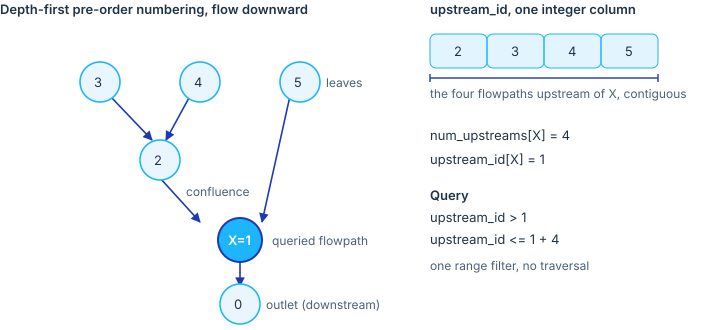

```{r, include = FALSE}
knitr::opts_chunk$set(collapse = TRUE, comment = "#>", eval = FALSE)
```

Most queries against a hydrofabric are upstream queries: what drains to a gage,
which catchments contribute to a reservoir, which reaches a subset needs to be
hydrologically complete above a point. Answering by traversal is correct but
costs a full graph walk per query.

`add_upstream_index()` precomputes the answer once, at build time, and stores it
as two integer columns so that "everything upstream of X" becomes a single
integer range filter. No traversal at query time.

## The idea: a nested set

The routed network is a tree. Each flowpath has exactly one downstream (a single
`toid`), so following flow downstream always converges, and following it upstream
fans out into a branching structure rooted at each outlet. Confluences, where
many reaches join one, are everywhere; divergences, where one reach splits into
two, are not present, because the data model stores a single downstream per
feature.

A tree admits a classic encoding, the *nested set model*. Number the flowpaths
in a depth-first pre-order walk from each outlet up its network. Because the walk
descends a whole branch before moving to the next, every flowpath and all of its
upstream contributors receive a contiguous run of numbers. Record two values per
flowpath:

- `upstream_id`: the pre-order position in that walk.
- `num_upstreams`: the count of flowpaths strictly upstream (the size of its
  contributing network).

The flowpaths strictly upstream of a flowpath `X` are then exactly those whose
`upstream_id` falls in the half-open interval

```
(upstream_id[X], upstream_id[X] + num_upstreams[X]]
```

One comparison on one indexed integer column returns the entire upstream
network. The technique is adapted from Josh Cunningham's
[upstream-index](https://github.com/joshcu/upstream-index) work
([DOI 10.5281/zenodo.21518730](https://doi.org/10.5281/zenodo.21518730)).



## Using it

The index is added during `finalize_data_model()`, so every product carries it.
The values live on `flowpaths` and are denormalized onto `flowlines`, `divides`,
and `network` by `flowpath_id`, so a feature on any layer resolves to its
flowpath's upstream network.

To list everything upstream of a flowpath, read its two values and filter:

```{r}
library(DBI)
con <- dbConnect(RSQLite::SQLite(), "superconus_ngen.gpkg")

anchor <- dbGetQuery(con,
  "SELECT upstream_id AS u, num_upstreams AS n
   FROM flowpaths WHERE flowpath_id = 'fp-8'")

upstream <- dbGetQuery(con, sprintf(
  "SELECT flowpath_id FROM flowpaths
   WHERE upstream_id > %d AND upstream_id <= %d",
  anchor$u, anchor$u + anchor$n))
```

The same filter selects upstream divides, or the upstream routing reaches, by
running it against those layers. Two features nest when one interval contains the
other, so `A` is upstream of `B` exactly when `A`'s interval sits inside `B`'s. A
range query costs one index seek regardless of how large the contributing network
is.

## What to keep in mind

`upstream_id` is build-specific. It is a position in one traversal of one
network, so it is reassigned whenever the topology changes and must not be used
as a persistent key. It accompanies the canonical `flowpath_id`; it never
replaces it.

The encoding is exact only for a tree. `add_upstream_index()` warns if a
flowpath falls outside its downstream's interval, and skips a network that is
not acyclic rather than writing a misleading index.
